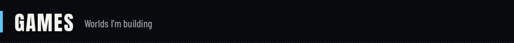
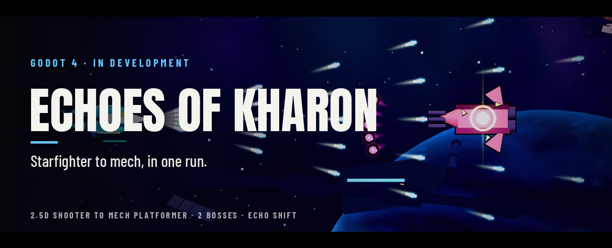
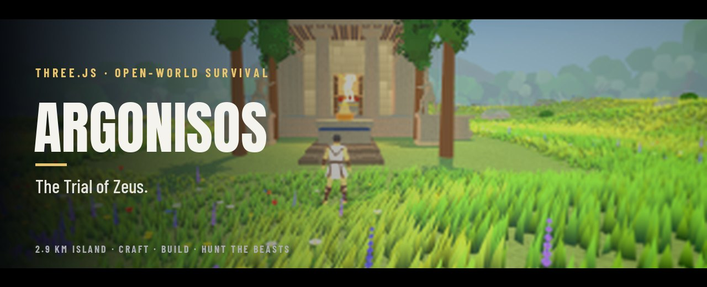
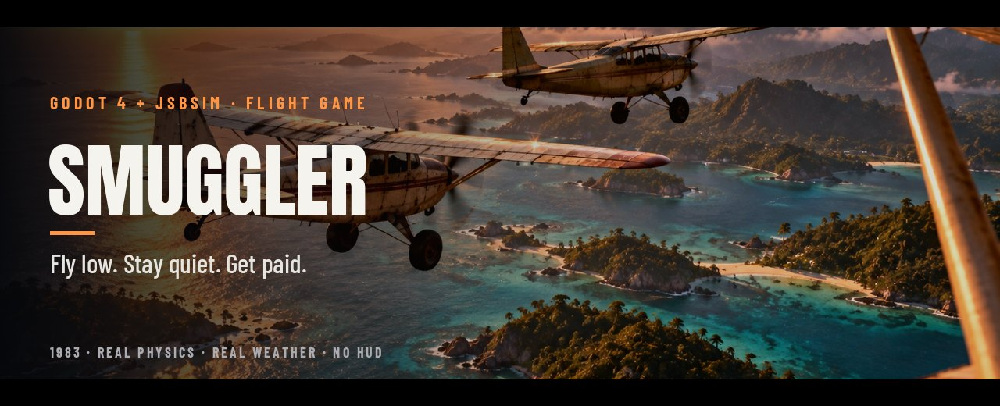
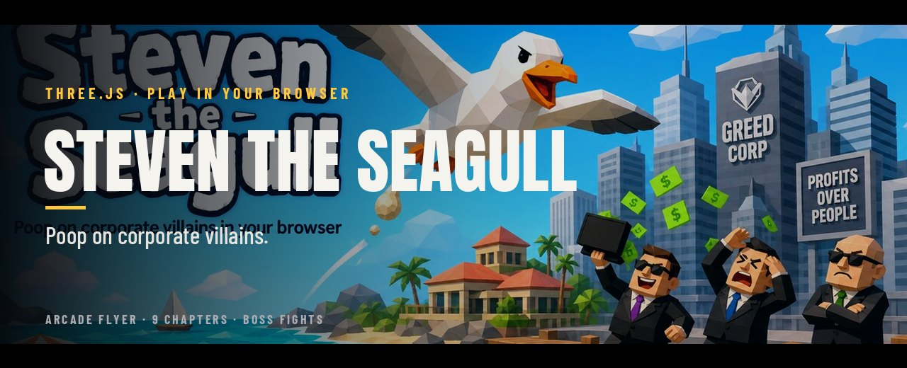
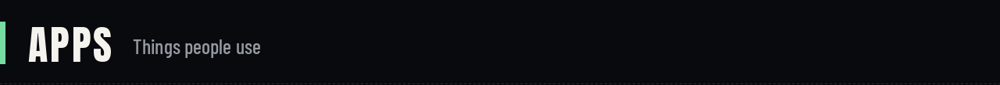
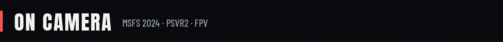
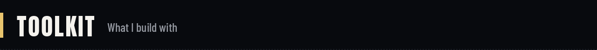
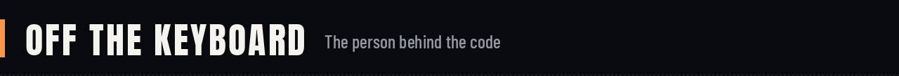

<div align="center">

<a href="https://nikolaskorakidis.com"></a>

# Nikolas Korakidis

**I build games, apps and the experiments that make them convert.**<br/>
Full-stack developer · Game maker · Content creator · CRO specialist<br/>
Greek 🇬🇷 living in the Netherlands 🇳🇱

<a href="https://nikolaskorakidis.com"></a>
<a href="https://steventheseagull.com"></a>
<a href="https://youtube.com/@YOUR_CHANNEL"></a>
<a href="https://www.linkedin.com/in/nikolaskorakidis"></a>
<a href="mailto:korakidisn@gmail.com"></a>

</div>

<br/>



<a href="https://github.com/NikolasKorakidis/Mecha-Techa-Soldier"></a>

**A 2.5D space shooter that becomes a mech platformer halfway through the run.** Decode enemy attack patterns into Burst, Arc and Guard modules, keep them through the transformation, and take down the Choir Engine and the Forge Regent.

<table><tr>
<td></td>
<td></td>
<td></td>
</tr></table>

`Godot 4` `typed GDScript` `component architecture` `data-driven Resources` `headless test suite` · 🛠️ In development · [**Repo →**](https://github.com/NikolasKorakidis/Mecha-Techa-Soldier)

<br/>

<a href="https://github.com/NikolasKorakidis/argonisos"></a>

**An open-world survival game in the browser, in the spirit of Valheim.** Wake on Nisos with nothing. Learn what you can craft from what you pick up, build shelter against the cold and rain, and hunt the beasts that rule each land.

<table><tr>
<td></td>
<td></td>
<td></td>
</tr></table>

`three.js` `2.9 km island` `crafting & building` `boss hunts` `Playwright visual tests + autoplay bot` · [**Repo →**](https://github.com/NikolasKorakidis/argonisos)

<br/>

<a href="https://github.com/NikolasKorakidis/smuggler"></a>

**It's 1983. You have a worn-out taildragger, a paper map and a buyer three islands away.** A flight game where the physics and the weather come first: real flight model, real skies, no HUD.

<table><tr>
<td></td>
<td></td>
<td></td>
</tr></table>

`Godot 4.7` `JSBSim flight model` `macOS + Windows` · Concept art · 🛠️ Early development · [**Repo →**](https://github.com/NikolasKorakidis/smuggler)

<br/>

<a href="https://steventheseagull.com"></a>

**Steven survived CorpoChem's BioLiquid-7 spill. Now he's coming for the Sky Barons.** A browser arcade game across nine chapters: the beach, the resort, the cruise ship, the docks, the factory and the Kraken.

<table><tr>
<td></td>
<td></td>
</tr></table>

`three.js` `Vite` `Netlify` · ▶️ [**Play it now at steventheseagull.com**](https://steventheseagull.com)

<details>
<summary><b>More games</b></summary>
<br/>

- **[Deep Forest](https://github.com/NikolasKorakidis/deepforest)**: a first-person long-range shooting game in three.js. Wake beside a crashed helicopter, range pop-up steel from 25 to 500 m and read the wind. The world, textures and terrain are all generated at runtime.

</details>

<br/>



<a href="https://nikolaskorakidis.github.io/gruppetto/"></a>

**Clubs plan rides. Members sign up as going / maybe / can't, pick a pace group, chat, grab the GPX and check the forecast.** Admins manage members, roles, invites and news.

`Expo` `React Native` `TypeScript` `Supabase + RLS` `MapLibre` `Open-Meteo` · ▶️ [**Try the live demo**](https://nikolaskorakidis.github.io/gruppetto/) · [Repo](https://github.com/NikolasKorakidis/gruppetto)

<br/>


**A language app for learning Greek and Dutch with your partner, a study buddy, or on your own.**

`Expo` `React Native Web` · [Web build](https://github.com/NikolasKorakidis/dualearning-web)

<br/>

| Project | What it does | Built with |
|---|---|---|
| **[HorecApp](https://github.com/NikolasKorakidis/HorecApp-Restaurant-Manager-FrontEnd)** | Free, open-source PoS for restaurants and bars: tables, QR menus, real-time orders | React · Node.js · GraphQL |
| **[CRO Scanner](https://github.com/NikolasKorakidis/cro-scanner)** | Audits any website for conversion issues using PageSpeed data and GPT recommendations | JavaScript · APIs |
| **[A/B Test Reports](https://github.com/NikolasKorakidis/abtestreport)** | Dashboard to set up, track and analyze A/B tests | React · TypeScript · MUI |
| **[Website Audit 2.0](https://github.com/NikolasKorakidis/Website-Audit-2.0)** | AI-powered website audit tool | Gemini · AI Studio |

<br/>



I make videos about the gear and games I actually use, recorded in OBS and edited in DaVinci Resolve.

| ✈️ **MSFS 2024** | 🥽 **PSVR2** | 🚁 **DJI Avata 2** | 🎮 **Gaming** |
|:---:|:---:|:---:|:---:|
| Flights, aircraft, setups | VR tests and impressions | FPV flying and footage | Whatever's worth playing |

<!-- Latest videos, auto-updated by a GitHub Action once the channel link is set -->
<!-- YOUTUBE:START -->
<!-- YOUTUBE:END -->

<p align="center"><a href="https://youtube.com/@YOUR_CHANNEL"><b>▶ Watch on YouTube</b></a></p>

<br/>



<p align="center">
  
</p>

| | |
|---|---|
| **Games** | Godot 4 · GDScript · three.js · JSBSim · Playwright visual testing |
| **Apps** | React · React Native / Expo · Next.js · TypeScript · Node.js · GraphQL · Supabase · Prisma |
| **CRO & analytics** | A/B testing · GA · GTM · Hotjar · Optimizely · VWO · Mixpanel |
| **Cloud** | AWS · Docker · Vercel · Netlify · Firebase |
| **Content** | OBS · DaVinci Resolve |

<br/>



```js
const nikolas = {
  from:     "Greece 🇬🇷 → the Netherlands 🇳🇱",
  day_job:  ["Full-stack dev", "CRO & A/B testing", "Team Captain @ Small Giants"],
  building: ["Echoes of Kharon", "Argonisos", "Smuggler", "Steven the Seagull", "Gruppetto"],
  flying:   ["MSFS 2024", "PSVR2", "DJI Avata 2"],
  offline:  ["🎸 Music production", "🏍️ Motorcycles", "🥋 MMA"],
  learning: "Solutions architecture",
};
```

<div align="center">

**Open to:** freelance web & CRO work · game dev collabs · playtesters · sim/VR/FPV brand partnerships

[**Get in touch →**](mailto:korakidisn@gmail.com)

</div>
