<a href="https://nikolaskorakidis.github.io/NikolasKorakidis/">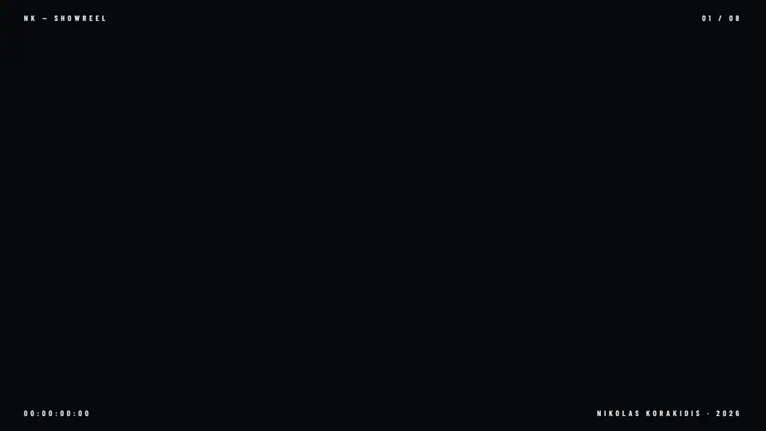</a>

<p align="center"><a href="https://nikolaskorakidis.github.io/NikolasKorakidis/"></a></p>

<p align="center">
  <a href="https://steventheseagull.com"></a>
  <a href="https://nikolaskorakidis.com"></a>
  <a href="https://www.youtube.com/@sleepinggianttv"></a>
  <a href="https://www.linkedin.com/in/nikolaskorakidis"></a>
  <a href="mailto:korakidisn@gmail.com"></a>
</p>

<br/>


<a href="https://steventheseagull.com">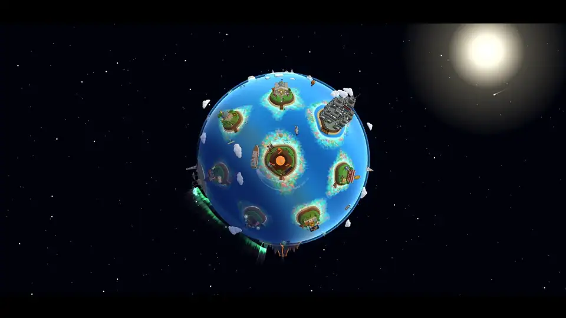</a>

<h3 align="center">Steven survived CorpoChem's BioLiquid-7 spill.<br/>Now he's coming for the Sky Barons.</h3>

<p align="center">A 3D arcade flyer that runs in your browser. Dive, bomb and boost through nine chapters of corporate villainy,<br/>from a quiet beach to the Kraken in the harbour and the Sky Barons' airship.</p>

<table>
<tr>
<td width="33%" align="center">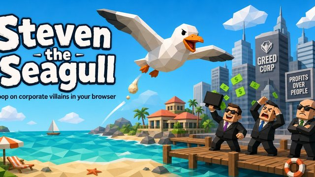<br/><sub><b>THE WORLD</b> · an island planet as the menu</sub></td>
<td width="33%" align="center">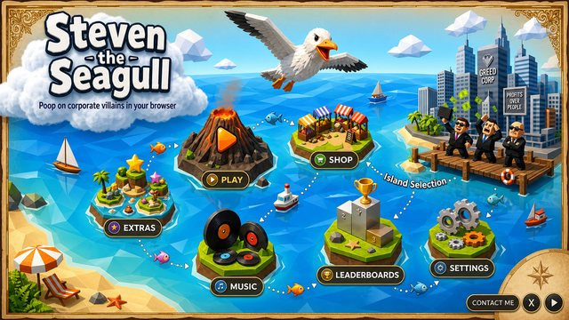<br/><sub><b>THE BEACH</b> · dive, bomb, combo</sub></td>
<td width="33%" align="center">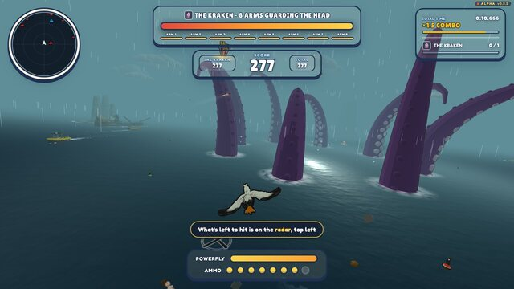<br/><sub><b>THE KRAKEN</b> · eight arms guarding the head</sub></td>
</tr>
<tr>
<td align="center">🗺️ <b>9 chapters</b><br/><sub>Beach · Resort · Cruise ship · Docks · Factory · Kraken · County Fair · City · Airship</sub></td>
<td align="center">⚔️ <b>Boss fights & arcade mode</b><br/><sub>Speedrun, ranked runs, achievements, unlockable birds</sub></td>
<td align="center">🌐 <b>No install</b><br/><sub>three.js + Vite, bot-tested every level</sub></td>
</tr>
</table>

<p align="center"><a href="https://steventheseagull.com"></a></p>

<br/>


<a href="https://github.com/NikolasKorakidis/Mecha-Techa-Soldier">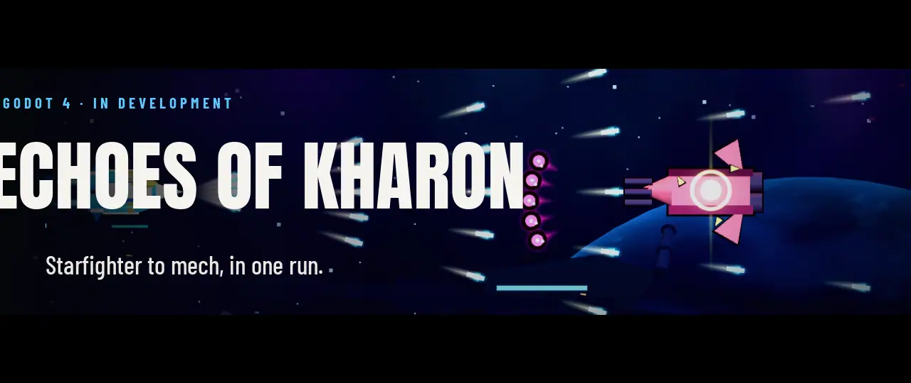</a>

> **A 2.5D space shooter that becomes a mech platformer halfway through the run.** Decode enemy attack patterns into Burst, Arc and Guard modules, carry them through the transformation, and take down the Choir Engine and the Forge Regent.

<table><tr>
<td>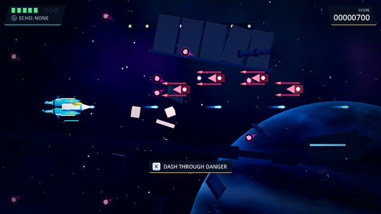</td>
<td>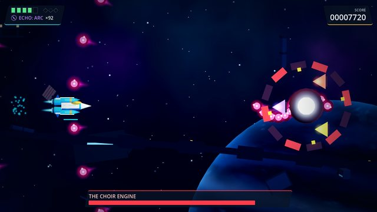</td>
<td>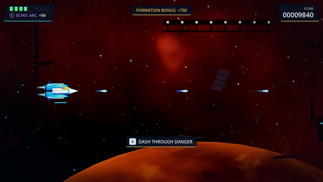</td>
</tr></table>

`Godot 4` `typed GDScript` `component architecture` `data-driven Resources` `headless tests` &nbsp;·&nbsp; 🛠️ In development &nbsp; <a href="https://github.com/NikolasKorakidis/Mecha-Techa-Soldier"></a>

<br/><br/>

<a href="https://github.com/NikolasKorakidis/argonisos">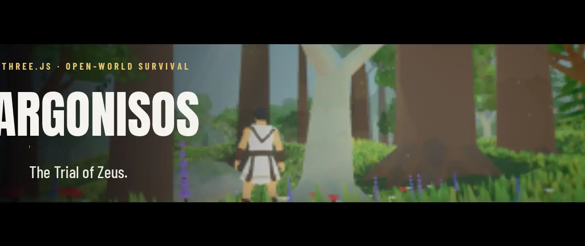</a>

> **An open-world survival game in the browser, in the spirit of Valheim.** Wake on Nisos with nothing. Learn what you can craft from what you pick up, build shelter against the cold and rain, and hunt the beasts that rule each land.

<table><tr>
<td>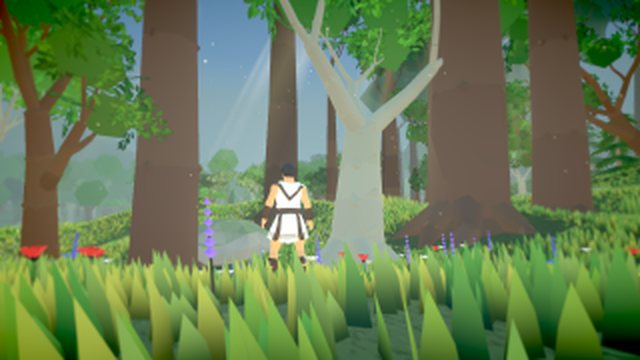</td>
<td>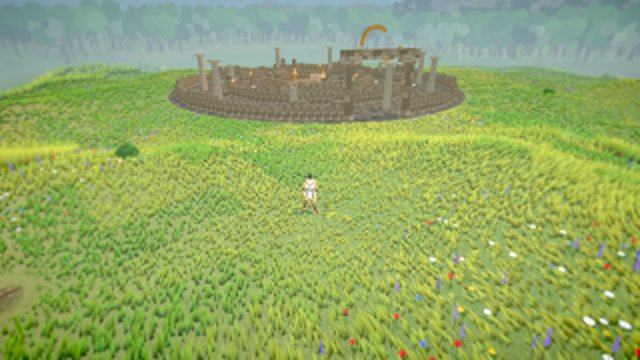</td>
<td>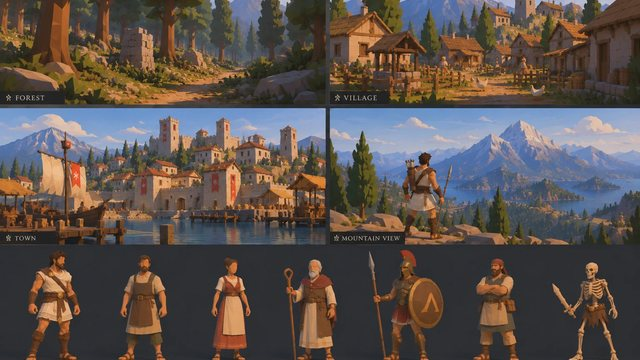</td>
</tr></table>

`three.js` `2.9 km island` `crafting & building` `boss hunts` `visual regression tests + autoplay bot` <a href="https://github.com/NikolasKorakidis/argonisos"></a>

<br/><br/>

<a href="https://github.com/NikolasKorakidis/smuggler">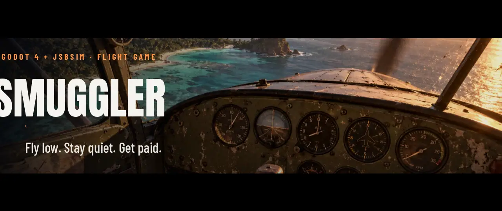</a>

> **It's 1983. You have a worn-out taildragger, a paper map and a buyer three islands away.** A flight game where the physics and the weather come first: a real flight model, real skies, no HUD.

<table><tr>
<td>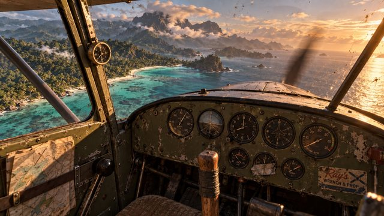</td>
<td>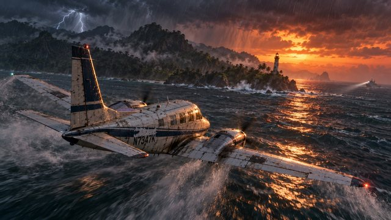</td>
<td>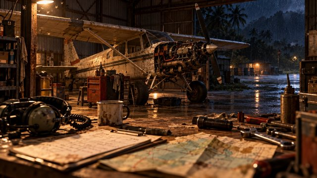</td>
</tr></table>

`Godot 4.7` `JSBSim flight model` `macOS + Windows` · concept art · 🛠️ early development <a href="https://github.com/NikolasKorakidis/smuggler"></a>

<br/>

<details>
<summary><b>🎯 One more: Deep Forest</b></summary>
<br/>

**[Deep Forest](https://github.com/NikolasKorakidis/deepforest)**: a first-person long-range shooting game in three.js. Wake beside a crashed helicopter, range pop-up steel from 25 to 500 m and read the wind. Terrain, grass, water and every texture are generated at runtime.

</details>

<br/>


<a href="https://nikolaskorakidis.github.io/gruppetto/">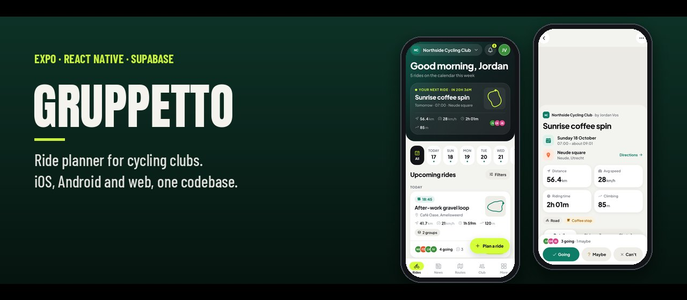</a>

> **Clubs plan rides. Members sign up as going, maybe or can't, pick a pace group, chat, grab the GPX and check the forecast.** One codebase for iOS, Android and the web.

`Expo` `React Native` `TypeScript` `Supabase + RLS` `MapLibre` `Open-Meteo`

<p align="center"><a href="https://nikolaskorakidis.github.io/gruppetto/"></a></p>

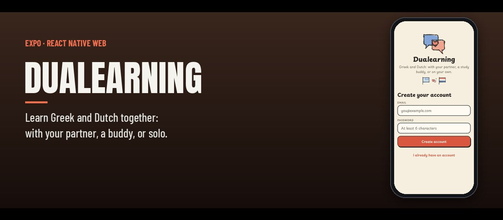

> **A language app for learning Greek and Dutch with your partner, a study buddy, or on your own.** `Expo` `React Native Web`

<br/>

| | Project | What it does | Built with |
|:---:|---|---|---|
| 🍽️ | **[HorecApp](https://github.com/NikolasKorakidis/HorecApp-Restaurant-Manager-FrontEnd)** | Free, open-source PoS for restaurants and bars: tables, QR menus, real-time orders | React · Node.js · GraphQL |
| 🔎 | **[CRO Scanner](https://github.com/NikolasKorakidis/cro-scanner)** | Audits a website for conversion issues using PageSpeed data and GPT recommendations | JavaScript · APIs |
| 📊 | **[A/B Test Reports](https://github.com/NikolasKorakidis/abtestreport)** | Set up, track and analyze A/B tests from one dashboard | React · TypeScript · MUI |
| 🧪 | **[Website Audit 2.0](https://github.com/NikolasKorakidis/Website-Audit-2.0)** | AI-powered website audit tool | Gemini |

<br/>


| ✈️ **MSFS 2024** | 🥽 **PSVR2** | 🚁 **DJI Avata 2** | 🎮 **Gaming** |
|:---:|:---:|:---:|:---:|
| Flights, aircraft, setups | VR tests and impressions | FPV flying and footage | Whatever's worth playing |

<!-- Latest videos: filled in every 6 hours by .github/workflows/latest-videos.yml -->
<!-- YOUTUBE:START -->
<table><tr><td width="33%" align="center"><a href="https://www.youtube.com/watch?v=HQI1TdGi5vc"></a><br/><sub>MSFS 2024 SU7, 10 Days Later: Free Air Races, a Drag Bug and SU7.1</sub></td><td width="33%" align="center"><a href="https://www.youtube.com/watch?v=yrh6K-wY2zg"></a><br/><sub>🔴 LIVE PS5 Pro - Platinum Trophy Hunt</sub></td><td width="33%" align="center"><a href="https://www.youtube.com/watch?v=KhgtXNBc1Ac"></a><br/><sub>🔴 LIVE PS5 Pro - Platinum Trophy Hunt</sub></td></tr><tr><td width="33%" align="center"><a href="https://www.youtube.com/watch?v=_OkDv_lJgi0"></a><br/><sub>Can One Guy Build a Realistic Flight Sim? | Smuggler Devlog #1</sub></td><td width="33%" align="center"><a href="https://www.youtube.com/watch?v=x7n4ov4oEJM"></a><br/><sub>This Flight Stick VIBRATES — Thrustmaster Hotas NEO Unboxing</sub></td><td width="33%" align="center"><a href="https://www.youtube.com/watch?v=7RM5OKNWfOk"></a><br/><sub>13 October 2026</sub></td></tr></table>
<!-- YOUTUBE:END -->

<p align="center">Recorded in OBS, cut in DaVinci Resolve. <a href="https://www.youtube.com/@sleepinggianttv"><b>Watch SleepingGiantTV on YouTube →</b></a></p>

<br/>


<p align="center">
  
</p>

| | |
|---|---|
| **Games** | Godot 4 · GDScript · three.js · JSBSim · Playwright gameplay bots & visual tests |
| **Apps** | React · React Native / Expo · Next.js · TypeScript · Node.js · GraphQL · Supabase · Prisma |
| **Growth** | A/B testing · CRO · GA · GTM · Hotjar · Optimizely · VWO · Mixpanel |
| **Ship** | AWS · Docker · Vercel · Netlify · Firebase |

<br/>


```js
const nikolas = {
  from:     "Greece 🇬🇷 → the Netherlands 🇳🇱",
  day_job:  ["Full-stack dev", "CRO & A/B testing", "Team Captain @ Small Giants"],
  building: ["Steven the Seagull", "Echoes of Kharon", "Argonisos", "Smuggler", "Gruppetto"],
  flying:   ["MSFS 2024", "PSVR2", "DJI Avata 2"],
  offline:  ["🎸 Music production", "🏍️ Motorcycles", "🥋 MMA"],
  learning: "Solutions architecture",
};
```

<div align="center">

**Open to** freelance web & CRO work · game dev collabs · playtesters · sim/VR/FPV brand partnerships

[**Get in touch →**](mailto:korakidisn@gmail.com)

</div>
